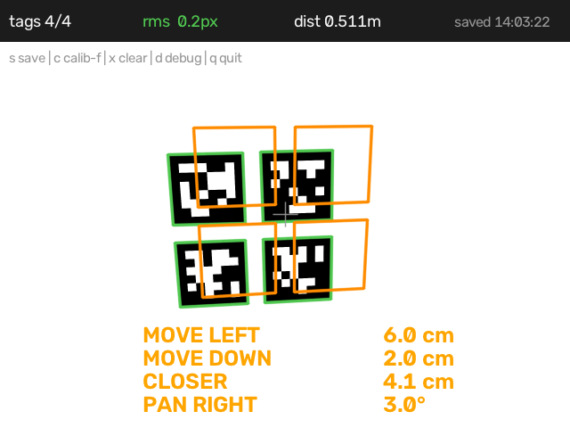

# tagpose

**AprilTag 6-DoF camera pose: measure a viewpoint, save it, and be guided back to it.**

[](https://github.com/wzqvip/tagpose/actions/workflows/ci.yml)
[](LICENSE)
[](pyproject.toml)



*The camera was nudged (3.5 cm right, 2 cm up, 4 cm back, 3° yaw). The orange wireframe
is where the tags should be; the arrows tell you how to get the camera back.*

---

## Why

A fine-tuned vision-language-action policy is extremely sensitive to where the camera
sits. Reported result: displacing the camera mount a small amount drops LIBERO success
from ~90% to ~10% in the worst case
([GS-VLA, arXiv:2608.19066](https://arxiv.org/abs/2608.19066)). Simulators are just as
sensitive the other way around — if `cam_pos` in your scene file is a guess, closed-loop
evaluation is measuring the wrong thing.

Both problems need the same missing ingredient: **the camera pose, relative to the scene,
as a number.** `tagpose` produces it from a printed tag board, and gives you a live UI to
get the camera back to a pose you saved earlier.

## What it does

1. **Measures** — 6-DoF camera pose from a bundle of AprilTags, plus distance to the
   bundle centre.
2. **Remembers** — press `s` to store the current viewpoint.
3. **Guides back** — afterwards it overlays the saved viewpoint as an orange wireframe and
   tells you `MOVE LEFT / MOVE UP / CLOSER / PAN LEFT / TILT UP`, until you are inside a
   configurable tolerance.
4. **Exports** — the same pose, written as `cameras.json` (and as MuJoCo `pos / quat /
   fovy`), so your simulator renders from where the camera actually is.

Tags are only needed while you calibrate; take the board away afterwards.

## Install

```bash
git clone https://github.com/wzqvip/tagpose
cd tagpose
pip install -e .
```

Needs `opencv-python >= 4.7` (ships the AprilTag dictionaries in `cv2.aruco`).
On a headless machine install `opencv-python-headless` and use `--headless`.

## Quickstart

```bash
# 0. no camera needed: check the install end to end
tagpose selftest

# 1. generate a board (A4: four 50 mm tags; A3: four 80 mm tags)
tagpose board --paper a4 --out board

# 2. print board.svg at 100% on matte paper, then measure one black square
#    with calipers -- printers are often ~0.5% off. Fix `size` in board.json
#    (or re-run with --tag-size 49.1) if it is wrong.

# 3. run the demo
tagpose guide --bundle board.json --camera 0

# 4. with real intrinsics (strongly recommended)
tagpose guide --bundle board.json --camera 0 --intrinsics intr.json
```

`intr.json`:

```json
{"fx": 505.3, "fy": 505.0, "cx": 319.6, "cy": 241.2, "dist": [-0.05, 0.01, 0, 0, 0]}
```

Without intrinsics the tool guesses `f` from a 60° horizontal FOV: distances are then a
few percent off, but the direction cues are unaffected.

### Keys

| key | action |
|---|---|
| `s` | save the current viewpoint (prints MuJoCo fields, optionally writes `cameras.json`) |
| `c` | one-point focal calibration (`--known-dist 0.40`, tag facing the camera) |
| `x` | clear the saved viewpoint |
| `d` | toggle key hints |
| `q` / `Esc` | quit |

## Output: `cameras.json`

```json
{
  "version": 1,
  "scene_frame": "board",
  "cameras": {
    "front": {
      "resolution": [640, 480],
      "intrinsics": {"fx": 505.3, "fy": 505.0, "cx": 319.6, "cy": 241.2},
      "T_scene_cam": {"R": [[...]], "t": [0.06, -0.12, 0.45]},
      "rms_px": 0.31,
      "mujoco": {"pos": [...], "quat_wxyz": [...], "xyaxes": [...], "fovy": 50.84}
    }
  }
}
```

`T_scene_cam` follows `p_scene = R @ p_cam + t`, with the OpenCV camera convention
(x right, y down, z forward). The `mujoco` block is a convenience mirror. Full contract:
[docs/cameras-schema.md](docs/cameras-schema.md).

Write it straight from the demo:

```bash
tagpose guide --bundle board.json --camera 0 --cameras-out cameras.json --name front
```

## CLI

| command | what it does |
|---|---|
| `tagpose board` | printable SVG/PNG board + the matching `board.json` |
| `tagpose guide` | live pose, save/recall, guidance HUD |
| `tagpose selftest` | hardware-free end-to-end check |
| `tagpose export` | turn a saved pose into a `cameras.json` entry |

`tagpose <command> --help` for the flags.

## How it works

Detection uses `cv2.aruco` with the `tag36h11` family. All visible tag corners are pooled
into a single PnP problem (sqpnp + LM refinement), which is both more accurate and less
ambiguous than solving per tag and averaging. Cues come from the relative pose

```
p_saved = R_err @ p_now + t_err        # current camera, in saved-camera coordinates
```

with the translation flipped into the *current* screen frame so "MOVE LEFT" means what
the person holding the camera expects. The math is written out in
[docs/guidance-math.md](docs/guidance-math.md) — short enough to port to C# or JS
verbatim, which is what a phone app needs.

## Accuracy

| setup | translation | rotation |
|---|---|---|
| one 80 mm tag @ 0.6 m | ~5 mm | 1–3° (planar pose ambiguity) |
| four-tag bundle, joint PnP | ~2 mm | ~0.3° |
| this repo's synthetic self-test | 0.8 mm | 0.08° (rms 0.15 px) |

The synthetic numbers are what the pipeline can achieve with perfect corners; the first
two rows are realistic expectations for a printed board in a room.

Rules of thumb: depth error grows with distance squared (`σ_z ≈ z²·σ_px / (f·s)`), so size
the tags for your working distance. Keep the board flat, matte, and rigid.

## Limitations

- Gives **camera** pose, not object poses. The board defines a frame; it does not locate
  your bowl.
- Planar bundles cannot remove the planar flip ambiguity — use a non-coplanar bracket if
  you need out-of-plane angle stability.
- If you leave the board in the scene, a policy trained without it will see it. Decide
  deliberately: remove the tags after calibration, or keep them and rebuild the dataset.
- It does not make a policy robust to viewpoint changes. It makes the viewpoint a
  measurable, repeatable quantity — what you do with that is data augmentation, mechanical
  indexing, or test-time view synthesis.

## Phone app

**Android app: [tagpose-android](https://github.com/wzqvip/tagpose-android)** — download the
APK from its [releases](https://github.com/wzqvip/tagpose-android/releases), install, and you
get the same measure → save → guide loop on a phone. It uses BoofCV's pure-Java AprilTag 3
detector (the Android OpenCV build has no `aruco` bindings), and its pose core was checked
against this CLI on the same four photos: distance agrees to 1 mm, rotation to 0.35°.

The Python CLI is still the reference implementation and the calibration path. For the
off-the-shelf alternatives and the reasons behind the choices, see
[docs/phone-demo.md](docs/phone-demo.md).

## 中文说明

**做什么**：用打印的 AprilTag 板测出相机相对场景的 6-DoF 位姿；按 `s` 存下当前视角；
之后画面里会出现橙色线框（"应回到的位置"）和 `MOVE LEFT / CLOSER / PAN LEFT` 之类的
提示，把相机推回原位；同时把位姿导出成 `cameras.json` 和 MuJoCo 的
`pos / quat / fovy`，让仿真按真实视角渲染。

```bash
tagpose selftest
tagpose board --paper a4 --out board      # 打印 board.svg，100% 不缩放，哑光纸
tagpose guide --bundle board.json --camera 0 --intrinsics intr.json \
              --cameras-out cameras.json --name front
```

标定完 tag 可以撤走。注意：别在采集数据集时把 tag 留在画面里，除非你打算重录。

## License

MIT. See [LICENSE](LICENSE).
